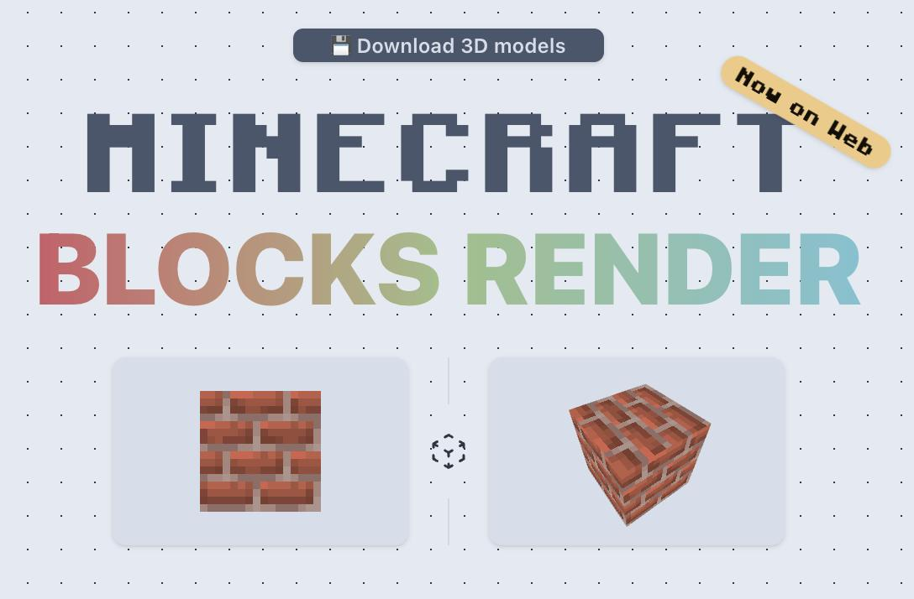
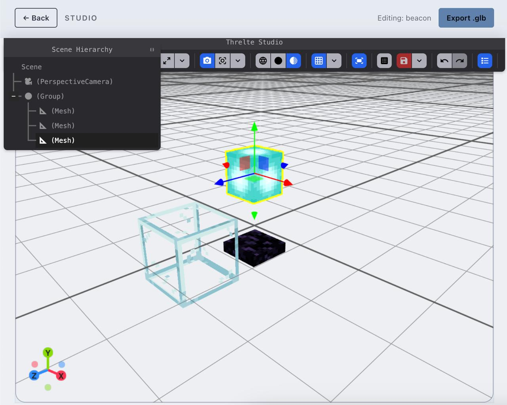
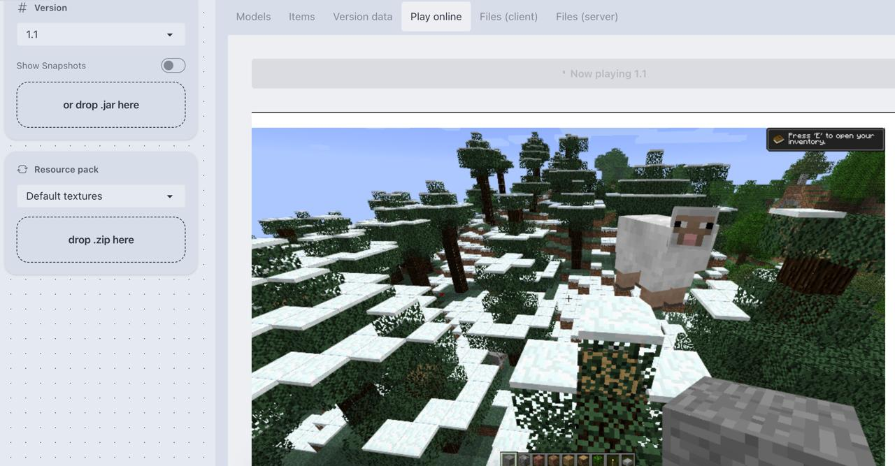
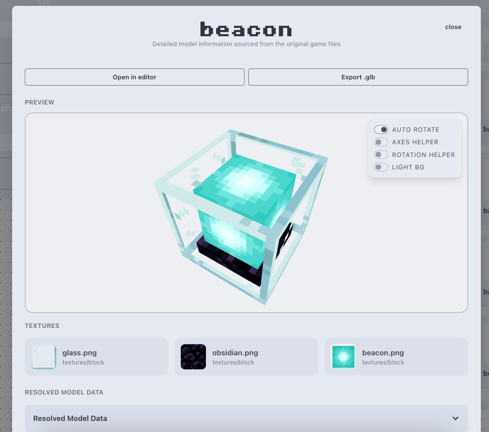
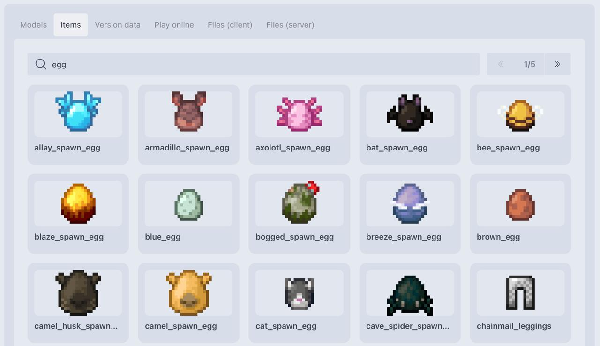
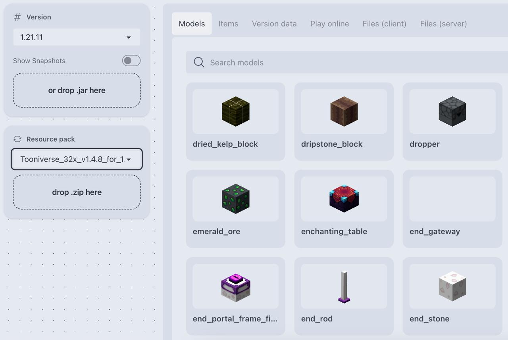
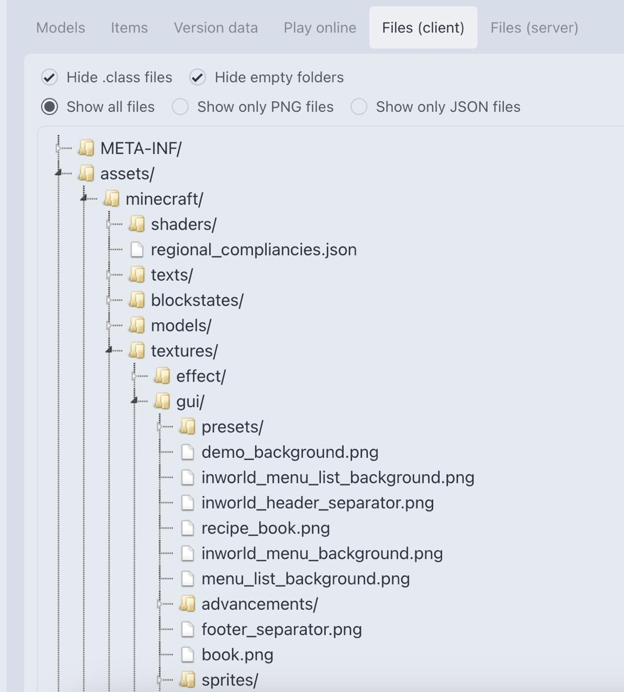

>Old cli-version is [here](https://github.com/TABmk/minecraft-blocks-render/tree/cli-version)

__Help__  

__Rate__ 

# Minecraft Block Render

  

> [The original idea](https://github.com/TABmk/minecraft-blocks-render/tree/cli-version) was to create a tool that could generate block previews for other tools, such as my [DeluxeMenus Editor](https://github.com/TABmk/deluxemenus-editor). However, the idea had many issues, including a lack of item support, a Node.js requirement, and poor usability. That’s why it has now been rebuilt as a web-based tool with additional features.

### Test it here 👇
### https://tabmk.github.io/minecraft-blocks-render

#### Features
- Fetch up-to-date official client files
- Preview client and server files
- **Play some versions online! 🤯**
- 3D models rendered from client data
- Export models as .glb
- Built-in model editor
- Resource pack support with editor and export
- Item previews
- Item, model, and version metadata
 

### Screenshots

  
  

  
  

  
  

